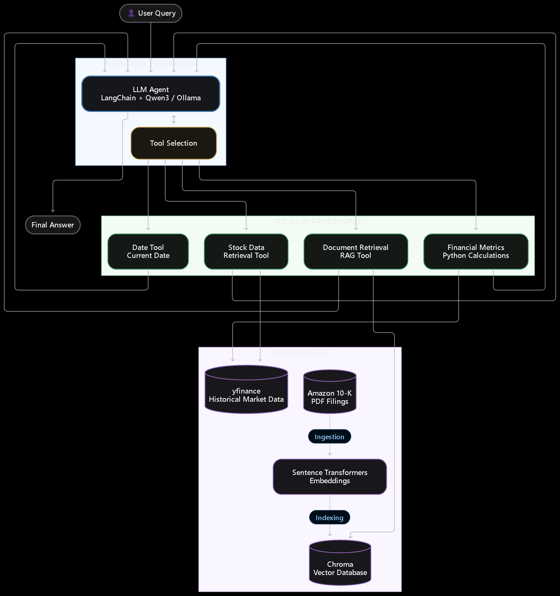

# Financial Research Agent

**Status: In Progress**

A Python-based financial research agent that combines an LLM, retrieval-augmented generation (RAG), and historical stock-market data to answer questions about company filings and stock performance.

The project focuses on improving agent reliability through document retrieval, tool calling, and deterministic financial calculations.

## Features

- **Financial document retrieval:** Search Amazon's annual 10-K filings using embeddings and a Chroma vector database.
- **Historical stock data:** Retrieve historical OHLCV data using `yfinance`.
- **Financial metrics:** Calculate average closing prices, highest and lowest prices, percentage changes, and other statistics using Python.
- **Tool calling:** Allow the LLM agent to select tools based on the user's request.
- **Evaluation:** A custom benchmark of 50 test cases covering retrieval, tool selection, financial calculations, date handling, and error handling.

## Architecture



The LLM handles request interpretation, tool selection, and response generation. Python tools handle data retrieval and numerical calculations, while Chroma provides access to indexed financial filings.

## Technology Stack

- **Language:** Python
- **Agent framework:** LangChain
- **LLM inference:** Ollama with Qwen3
- **Retrieval:** Chroma and Hugging Face Sentence Transformers
- **Embedding model:** `sentence-transformers/all-MiniLM-L6-v2`
- **Market data:** `yfinance`
- **Data validation:** Pydantic

## Example Queries

- "What are Amazon's main business segments?"
- "What does Amazon's 10-K say about operating cash flow?"
- "What was Amazon's average closing price over a specified date range?"
- "What was the percentage change in Amazon's stock price over a given period?"

These are examples of intended use; answer accuracy and tool selection are still being evaluated.

## Installation

### Prerequisites

- Python
- Git
- [Ollama](https://ollama.com/) for local model inference
- Amazon 10-K PDF filings for document ingestion

### Setup

Clone the repository:

```bash
git clone https://github.com/FallB-Tec/Agent-fo.git
cd Agent-fo
```

Create and activate a virtual environment.

**Windows (PowerShell):**

```powershell
python -m venv .venv
.\.venv\Scripts\Activate.ps1
```

**macOS / Linux:**

```bash
python -m venv .venv
source .venv/bin/activate
```

Install the dependencies:

```bash
pip install -r requirements.txt
```

Pull the local model if needed:

```bash
ollama pull qwen3:14b
```

Ensure that the model identifier matches the application configuration. If the vector database has not been built, run the document-ingestion process before querying financial filings.

*Note: Verify the installation and startup instructions against the current implementation.*

## Evaluation

The custom benchmark contains 50 test cases designed to evaluate:

- Tool selection and routing
- Financial document retrieval
- Historical stock-data queries
- Financial calculations
- Relative-date interpretation
- Multi-tool requests and error handling

Evaluation is ongoing. Current work focuses on retrieval relevance, final-answer correctness, and distinguishing model failures from retrieval or infrastructure issues.

LangSmith integration is planned for tracing and more structured evaluation experiments.

## Current Limitations and Future Work

- Improve retrieval relevance and financial-document chunking.
- Increase tool-selection reliability across models.
- Strengthen factual-grounding and answer-correctness evaluation.
- Improve relative-date handling and error recovery.
- Expand document coverage beyond Amazon.
- Explore a user interface or API.

## Disclaimer

This project is for educational and research purposes only. Retrieved information may be incomplete, and generated answers may contain errors. Verify important financial claims against authoritative sources before relying on them for investment decisions.
